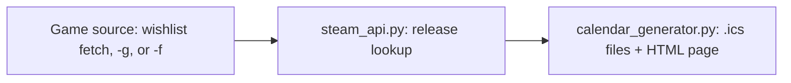

# Contributing

How to run the tool locally, where things live, and its one CI check. What
it does for a user is in [features.md](features.md).

## Run it locally

```sh
pip install -r requirements.txt
```

You need a Steam Web API key (from
[steamcommunity.com/dev/apikey](https://steamcommunity.com/dev/apikey)) in
a `.env` file (git-ignored):

```
STEAM_API_KEY=your_key_here
```

Then, to fetch your own wishlist and build calendar events in one step:

```sh
python main.py YOUR_STEAM_ID
```

or, to skip fetching and supply games yourself:

```sh
python main.py -f wishlist.txt
python main.py -g "Game1, Game2, Game3"
```

Your Steam profile and wishlist must be set to Public (Steam profile > Edit
Profile > Privacy Settings) for the fetch path to work at all.

## Architecture

Three stages run in order, each handing its output to the next:



| Path                    | What it is                                                                                 |
| ------------------------ | ------------------------------------------------------------------------------------------- |
| `main.py`                | the CLI entry point: picks a game source, calls the lookup and export steps, opens the result |
| `fetch_wishlist_api.py`  | standalone script `main.py` shells out to for the wishlist fetch; see [features.md](features.md#wishlist-fetching) |
| `steam_api.py`           | release-date lookup (imported by `main.py`), plus an unreachable wishlist-scraping fallback that `main.py` never calls |
| `calendar_generator.py`  | `.ics` file writing and the HTML page with Google Calendar / download links                |
| `wishlist.txt`, `wishlist_api_response.json`, `fetch_wishlist_api.log` | output committed from a run of the tool                                                    |

There is no package layout beyond these four scripts; `main.py` imports
directly from the other two Python modules and shells out to
`fetch_wishlist_api.py` as a subprocess rather than importing it.

## Tests and gates

There are no unit tests. The only CI is `.github/workflows/vibecheck.yml`, a
manually-triggered static-analysis workflow (`WolffM/vibecheck@main`).
Four Copilot-authored commits followed it into the repo: three on the day
the workflow was added (lint prefixes, an unnecessary f-string, explicit
workflow permissions) and one six days later (a missing mypy type stub)
— see [history.md](history.md).

## How it deploys

It doesn't: this is a script you run on your own machine with your own
Steam API key, not a deployed service. A push to the default branch
triggers no build.

## Trivia

`requirements.txt` pins `selenium` and `webdriver_manager`, but every
network call in the repo goes through plain `requests` calls instead; both
packages have been dead weight since they were added on the tool's second
day (`e78c70d`).
