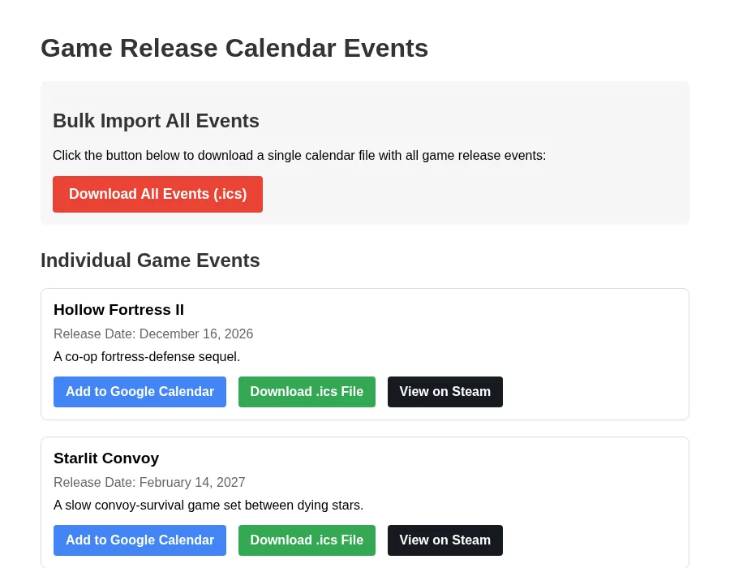

# Steam Games to Calendar

A single command turns a Steam wishlist into calendar reminders. Give it a
Steam ID (or just a list of game names), and it looks up each game's
release date on Steam. It writes an `.ics` calendar file for every
upcoming release, and opens a page where you can add them to Google
Calendar one at a time, or download them all in one file.

- [Features](features.md): what each piece does and how to run it.
- [Contributing](contributing.md): running it locally, its layout, what has no tests.
- [History](history.md): two days of building in March 2025, then a lint-and-typing pass ten months later.
- [Trivia](trivia.md)

## Trivia

Fetching a Steam wishlist tries three API-style methods in sequence; a
fourth, HTML-scraping method also exists in the repo but is never actually
reachable from a normal run
([features](features.md#wishlist-fetching)).
